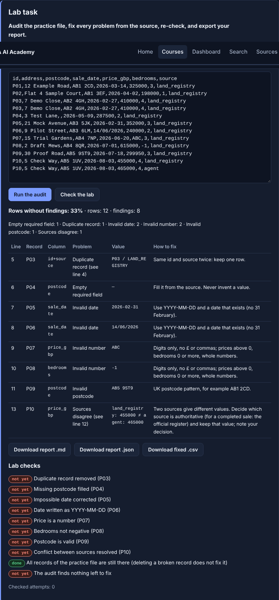
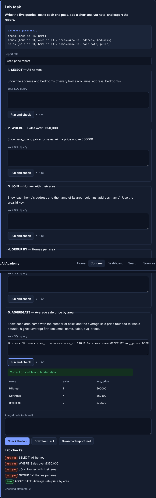
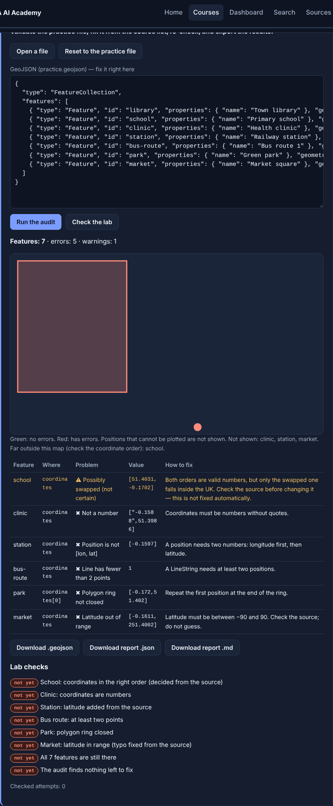
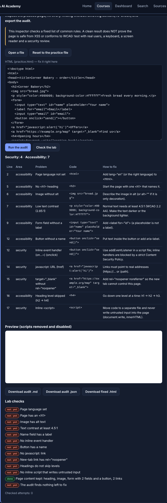

# KUBERA Claude Academy

    

**Live site:** https://kubera-claude-academy.pages.dev (after the first release)

## Start in one minute
1. Open the site. No account, no sign-up.
2. Press **EN / RU** at the top right to choose the language.
3. Open **Courses** and pick one of the 8 courses.
4. Each course: read the short lesson → do the **warm-up** → do the **lab** → finish with the **final project** (a real tool).
5. Press **Check** in any task: the result appears at once, with what to fix.
6. Download your final project files and add them to your GitHub portfolio. Progress is saved in your browser; **Dashboard → Download progress backup** saves it as a file.

## Screenshots
| CSV Data Quality Auditor | SQL Report Builder |
|---|---|
|  |  |
| **GeoJSON Coordinate Validator** | **Web Quality Inspector** |
|  |  |

## Two academies, two roles
KUBERA runs two separate learning platforms. They are developed independently and do not share code.

| | KUBERA Claude Academy (this repository) | KUBERA Gemini Academy |
|---|---|---|
| Repository | `kubera-lab/kubera-claude-academy` | `kubera-lab/kubera-ai-academy` |
| Site | kubera-claude-academy.pages.dev | its own Cloudflare Pages project |
| Built with | Claude | Gemini |
| Focus | Hands-on tools and honest, fixed-rule checks; portfolio evidence | UI/UX and its own course set |

> This platform started as v1.0 in `kubera-ai-academy` (PR #1, written by Claude) and moved here on 23 Nov 2026 when the two academies were split. This project never changes the Gemini Academy.

Free, self-paced AI courses for adult beginners. Every lesson ends with a task that is **checked automatically by fixed rules** — real SQL runs in the browser, real JavaScript runs against hidden tests. No account, no paid AI service, no tracking.

**Principle:** LEARN → BUILD → TEST → VERIFY → PORTFOLIO.

## What is in v1.0

| # | Course | Units | Lab |
|---|---|---|---|
| 1 | AI Fundamentals | 4 | Is AI the right tool? (decisions with written evidence) |
| 2 | Prompt Engineering | 4 | System prompt for a bike repair shop (6 required + 4 quality checks) |
| 3 | Build Your First AI Assistant | 5 modules + final project | Offline assistant, knowledge validator, test runner, control tests, export |
| 4 | AI Agents and Automation | 4 | Permission guard in JavaScript (visible + hidden tests) |
| 5 | Data Quality with AI | 4 | Property record matching with evidence |
| 6 | SQL and Data Analytics | 4 | Duplicate detection in SQLite (visible + hidden dataset) |
| 7 | GIS and Official Open Data | 4 | Nearest-place finder with haversine distance |
| 8 | AI-Assisted Web Development | 4 | Listing filter for a small app |

47 learning units in total (42 lessons + 5 modules), plus the course 3 final project.

### New in v1.1 — beginner standard and a final-project tool in every course

Every course now has a bilingual **glossary** (EN/RU) for absolute beginners and a **warm-up** before the lab that explains each answer straight away, and ends with a real working tool:

| Course | Final-project tool | What it really does | Exports |
|---|---|---|---|
| 1 · AI Fundamentals & Safety | **AI Use-Case Safety Review** | Risk card from four questions (who is affected, data, who decides, impact) → risk level and required safeguards by fixed rules; three graded cases + the learner's own | cards `.md` |
| 2 · Prompt Engineering & Testing | **Prompt A/B Tester** | Two prompt versions checked by the same rulebook (6 required + 4 quality checks); optional pasted model replies graded by fixed rules; no built-in model | report `.md`, `.json` |
| 3 · AI Assistant Development | Own assistant project (unchanged) | Offline assistant, knowledge validator, test runner, control tests | project files |
| 4 · AI Agents & Automation | **Agent Trace Debugger** | Reads an agent's action log against a permission policy: forbidden tools, missing approval, external recipients, prompt injection followed, loops, missing results, false claims; learner diagnoses first | review `.md`, `.json` |
| 5 | **CSV Data Quality Auditor** | Parses CSV (quotes, commas, CRLF), checks required fields, duplicates, calendar dates, numbers, UK postcodes and conflicts between sources; shows line, record, column, value and fix; deterministic score | report `.md`, `.json`, fixed `.csv` |
| 6 | **SQL Report Builder** | Five queries (SELECT, WHERE, JOIN, GROUP BY, aggregate) on three related tables in real SQLite (sql.js); visible + hidden dataset; plain-language SQL errors; read-only practice database | `.sql`, report `.md` with real results |
| 7 | **GeoJSON Coordinate Validator** | RFC 7946 structure, ranges, NaN/text/missing values, lines and closed rings; certain lat/lon swaps can be fixed by a button, ambiguous ones are warnings only; map preview | `.geojson`, report `.json`, `.md` |
| 8 | **Web Quality Inspector** | Common XSS risks (inline scripts and handlers, `javascript:` URLs, unsandboxed iframes, `target=_blank` without `noopener`) and accessibility basics (lang, headings, alt, labels, names, WCAG 2.x contrast for inline colours); preview in a sandboxed iframe with scripts removed | audit `.md`, `.json`, fixed `.html` |

Each tool also works on the learner's own file (opened locally; nothing is uploaded). The lab check applies only to the practice file, and deleting a broken record never counts as fixing it. The tools load lazily as separate bundles.

Platform features: course catalogue, interactive lessons, labs, knowledge checks, project builder, test runner, progress tracking, learning history, search, portfolio export (Markdown), progress backup/restore (JSON), English and Russian interface.

## How results are decided

- Multiple choice and labelling: fixed answer keys. The explanation for a wrong answer appears after the second attempt, so guessing is not rewarded.
- Written evidence: must be a real sentence (6+ words, real words, not repeated) that names the compared field or the risk.
- JavaScript labs: code runs for real in a disposable Web Worker (2-second limit, no network or storage APIs) against visible and hidden tests.
- SQL labs: queries run in SQLite compiled to WebAssembly ([sql.js](https://github.com/sql-js/sql.js), MIT) on a visible and a hidden dataset; hard-coded answers fail. Only one read query (SELECT/WITH) is allowed.
- A pass belongs to the exact answer and content version that were graded. Editing passed work removes the pass until it is checked again.
- Tasks that cannot be judged objectively are marked "needs human review" and are never counted as passed.
- No AI model decides any result.

## AI tutor

Not connected. `functions/api/tutor.ts` is a Cloudflare Pages Function that documents the future interface and returns `501 not_configured`. No API keys are stored in the browser and no fake AI replies are shown.

## Run locally

```bash
npm ci
npm run dev              # development server
npx tsc --noEmit         # type check
npx --yes tsx --test src/data/*.test.ts   # content and integration tests
npm test                 # all unit + integration tests
npm run build            # production build into dist/
npx vite preview --port 4173 &  npm run e2e   # Playwright end-to-end tests against the build
```

## Project structure

```
src/content/        course content (data only), extras.ts (glossaries, warm-ups, final tools), sources and research register
src/engine/         deterministic graders: grade.ts, lint.ts, assistant.ts, testing.ts, project.ts, portfolio.ts
src/engine/tools/   course 5–8 tools: csv.ts, sqlreport.ts, geojson.ts, web.ts (pure, unit-tested)
src/ui/tools/       lazily loaded tool screens
src/runtime/        sql.js loader and Web Worker code runner
src/ui/, src/pages/ React components
src/i18n/           en.ts and ru.ts (a test fails if a Russian key is missing)
src/data/           course 3 content, Russian text, and integration tests
e2e/run.ts          Playwright walkthrough of every lesson, a11y (axe-core), mobile, keyboard, export
functions/api/      tutor interface stub for Cloudflare Pages
```

## Deploy (free)

`.github/workflows/deploy.yml` checks, builds, runs the end-to-end tests and publishes `dist/` to the Cloudflare Pages project **kubera-claude-academy** (free plan) on every push to `main`. It needs one repository secret, `CLOUDFLARE_API_TOKEN`; without it the job still checks and builds and skips publishing. No paid service is required: all courses work without any AI API, and the tutor function stays a 501 stub.

## Contributing

See [CONTRIBUTING.md](CONTRIBUTING.md) and the issue templates (bug, content, tool).

## Sources

Each lesson lists its sources with the date they were checked (2026-11-16) and their licence. Lessons explain ideas in their own words; no third-party lesson text is copied. Ideas taken from other platforms (for example separate knowledge and practical scores, hidden tests, automatically evaluated final projects) are listed with their licences on the in-app **Sources** page.

## Limitations

- Progress is stored only in the learner's browser (backup file available); no accounts, no sync, no certificates.
- Checkers use fixed rules; they cannot fully understand meaning.
- The course 3 practice assistants and the prompt checker work in English.
- Example organisations, addresses, UPRNs and prices are fictional or synthetic.
- The Web Quality Inspector checks a fixed list of rules with a lightweight HTML reader; it cannot prove a page is safe from XSS or WCAG-conformant, and contrast is checked only for inline colours.
- The GeoJSON Validator warns about positions outside the UK; it does not know the true location of a place, so possible swaps must be decided from a source.
- The SQL lab checks are kept for the current page session; after a reload run the queries again to see their status (passes are stored).
